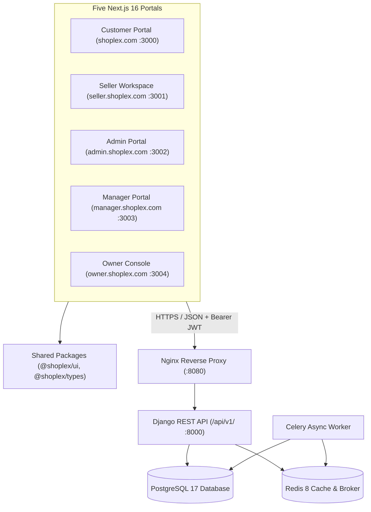

# SHOPLEX Architecture & Database ER Diagram

## 1. System Topology

Five separate Next.js 16 applications share React/TypeScript UI (`@shoplex/ui`) and types (`@shoplex/types`). All portals communicate with one centralized, versioned Django REST API (`/api/v1/`). PostgreSQL is the primary relational data store (with SQLite fallback for zero-dependency local checks); Redis backs Celery workers and caching; Nginx provides reverse-proxy routing.

## 2. PostgreSQL Entity-Relationship Diagram

All monetary columns use exact `DECIMAL(12, 2)` representation — never floating-point numbers. User-facing primary keys use UUIDs, with relational foreign keys, uniqueness constraints, check constraints, and composite indexes.

```mermaid
erDiagram
    USER ||--o| USER_PROFILE : "has"
    USER ||--o{ USER_ROLE : "assigned"
    ROLE ||--o{ USER_ROLE : "grants"
    ROLE ||--o{ ROLE_PERMISSION : "includes"
    PERMISSION ||--o{ ROLE_PERMISSION : "attached_to"
    USER ||--o{ USER_PERMISSION : "overrides"
    PERMISSION ||--o{ USER_PERMISSION : "target"
    USER ||--o{ AUTH_SESSION : "tracks"
    USER ||--o{ MFA_DEVICE : "enrolls"
    USER ||--o| SELLER_PROFILE : "operates"
    USER ||--o{ SELLER_APPLICATION : "submits"
    SELLER_APPLICATION ||--o{ SELLER_DOCUMENT : "attaches"
    SELLER_APPLICATION ||--o{ SELLER_APPLICATION_APPROVAL : "reviewed_by"
    USER ||--o| MANAGER_PROFILE : "holds"
    USER ||--o{ NOTIFICATION : "receives"
    USER ||--o{ AUDIT_LOG : "actor"

    SELLER_PROFILE ||--o{ PRODUCT : "publishes"
    CATEGORY ||--o{ PRODUCT : "classifies"
    BRAND ||--o{ PRODUCT : "labels"
    PRODUCT ||--o{ PRODUCT_IMAGE : "displays"
    PRODUCT ||--o{ PRODUCT_VARIANT : "options"
    PRODUCT ||--o{ PRODUCT_APPROVAL : "moderated_by"
    PRODUCT ||--o{ PRODUCT_REVIEW : "rated_in"

    USER ||--o{ ADDRESS : "ships_to"
    USER ||--o| CART : "owns"
    CART ||--o{ CART_ITEM : "contains"
    USER ||--o{ ORDER : "places"
    ORDER ||--o{ SELLER_ORDER : "splits_into"
    SELLER_PROFILE ||--o{ SELLER_ORDER : "fulfills"
    SELLER_ORDER ||--o{ ORDER_ITEM : "lines"
    ORDER ||--o{ PAYMENT : "records"
    SELLER_ORDER ||--o| SELLER_EARNING : "settles"
    SELLER_PROFILE ||--o{ SELLER_PAYOUT_REQUEST : "requests"
    SELLER_ORDER ||--o{ RETURN_REQUEST : "returns"
```

## 3. Domain Module Boundaries

- **`apps.accounts`**: Custom UUID `User` model (`email` as `USERNAME_FIELD`), `UserProfile`, Argon2 password hashing, registration, signed email verification, password recovery, rotating JWT login/refresh, and session revocation.
- **`apps.authorization`**: Normalized `Role` (`customer`, `seller`, `admin`, `manager`, `owner`), `Permission`, `RolePermission`, `UserRole`, and expiring `UserPermission` overrides. Enforced server-side via `user_has_permission` and DRF permission classes.
- **`apps.platform`**: `AuthSession` (with refresh JTI lock rotation), `MFADevice`, `SellerProfile`, `SellerApplication`, `SellerDocument`, `SellerApplicationApproval`, `ManagerProfile`, `ManagerInvitation`, `Notification`, append-only `AuditLog`, and `PlatformSetting`.
- **`apps.catalog`**: `Category`, `Brand`, `Product`, `ProductImage`, `ProductVariant`, dual-review `ProductApproval`, verified-purchase `ProductReview`, `MarketingBanner`, and `NewsletterSubscription`.
- **`apps.commerce`**: `Address`, `Cart`, `CartItem`, `WishlistEntry`, `Coupon`, `CouponRedemption`, `ShippingRule`, `CommissionRule`, idempotent multi-seller `Order`, `SellerOrder`, `OrderItem`, `Payment`, `SellerEarning`, `SellerPayoutRequest`, `ReturnRequest`, and permission-scoped `ManagementOverviewView` (`/api/v1/management/overview/`).
- **`apps.sellers`**: Seller application submission, private verification document download, Admin + Owner dual-approval cycle service, seller dashboard metrics, and balance-validated payout requests.

## 4. Design System Architecture (`@shoplex/ui`)

- **Palette Tokens**:
  - Deep Midnight Navy: `#0F172A` / `#111827`
  - Rich Cobalt Blue: `#2563EB` / `#4F46E5`
  - Warm Off-White: `#FAF9F6`
  - Pure White Surface: `#FFFFFF`
  - Refined Champagne Gold: `#C8A96B`
  - Slate Gray: `#64748B`
- **Typography**: `Playfair Display` for editorial and executive headings paired with `DM Sans` for high-legibility UI controls, tables, and financial metrics.
- **Core Components**: `Button`, `TextInput`, `SelectInput`, `TextareaInput`, `Checkbox`, `Card` (`CardHeader`, `CardBody`, `CardFooter`), `StatCard`, `AreaChart`, `BarChart`, `DataTable`, `Modal`, `Sidebar`, `TopNav`, `PortalShell`, `Breadcrumbs`, `Tooltip`, `StatusPill`, `Badge`, `Notification`, `Icon`, `LoadingState`, `Skeleton`, `EmptyState`, and `ErrorState`.
